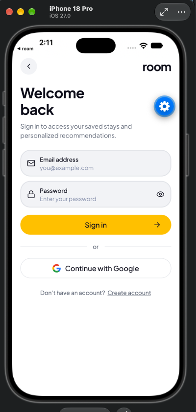
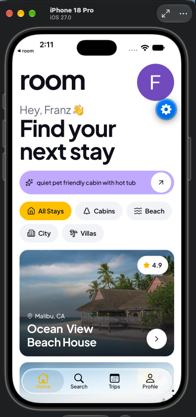
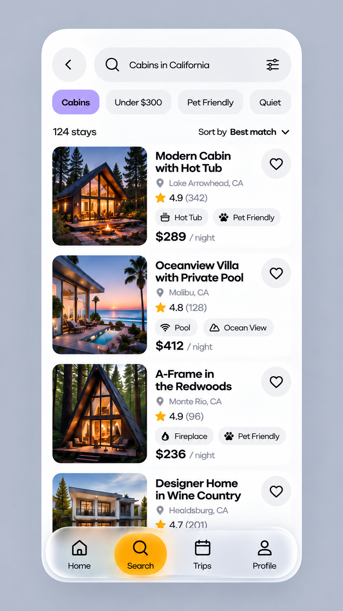
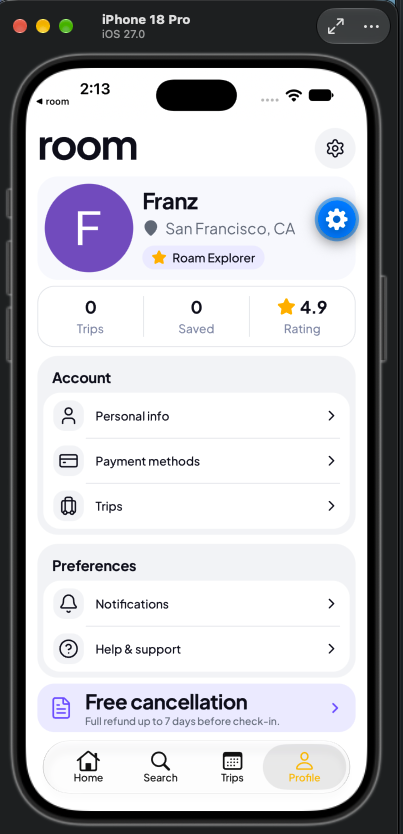

# Room 🏠

Room is a premium Expo React Native rental application that allows guests to find their perfect stay using natural language. Instead of complex filters, users can describe their ideal trip in a single sentence, and Room provides a ranked list of stays that match their intent.

## ✨ Key Features

- **Natural Language Search:** Describe a stay (e.g., *"quiet pet friendly cabin with a hot tub under $300 a night"*) and get AI-ranked results.
- **AI-Powered Policy Q&A:** Ask specific questions about a stay's policies and receive exact, cited answers from the property's documentation.
- **Curated Stay Details:** Rich property pages with high-resolution galleries, amenity highlights, and host information.
- **Seamless Authentication:** Secure onboarding and account management.
- **Modern Design:** A polished, native experience with a sophisticated design system.

## 📸 App Walkthrough

Below are the key screens of the Room experience:

| Screen | Preview |
| :--- | :--- |
| **Onboarding** |  |
| **Login** |  |
| **Sign Up** |  |
| **Home** |  |
| **Search** |  |
| **Profile** |  |
| **AI Assistant** |  |

## 🛠 Tech Stack

### Frontend
- **Framework:** [Expo](https://expo.dev/) (React Native)
- **Routing:** [Expo Router](https://docs.expo.dev/router/introduction/) (File-based routing)
- **Styling:** [NativeWind](https://www.nativewind.dev/) (Tailwind CSS for React Native)
- **Animations:** [React Native Reanimated](https://reanimated.sysfme.com/)
- **UI Components:** `@expo/ui` (Bottom Sheets, etc.)
- **Icons:** [Lucide React Native](https://lucide.dev/)

### Backend & Infrastructure
- **CMS:** [Sanity.io](https://www.sanity.io/) (Content Lake for stays, hosts, and policies)
- **Authentication:** [Clerk](https://clerk.com/)
- **AI/ML:** 
  - **Sanity Context:** For RAG-based policy answering.
  - **Dataset Embeddings:** For semantic search and ranking.
  - **TypeSafe AI (Jev):** For intent parsing and structured decisions.
- **Analytics:** [PostHog](https://posthog.com/)

## 🚀 Getting Started

### Prerequisites
- Node.js
- Expo Go or an iOS/Android Simulator

### Installation
1. Clone the repository:
   ```bash
   git clone <repository-url>
   cd room
   ```
2. Install dependencies:
   ```bash
   npm install
   ```
3. Start the development server:
   ```bash
   npx expo start
   ```

### Useful Commands
- `npx expo lint` - Run linting
- `npx tsc --noEmit` - Type check the project
- `npx expo-doctor` - Diagnose project health
